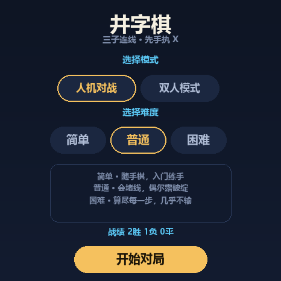
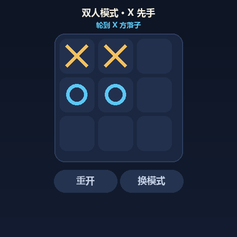
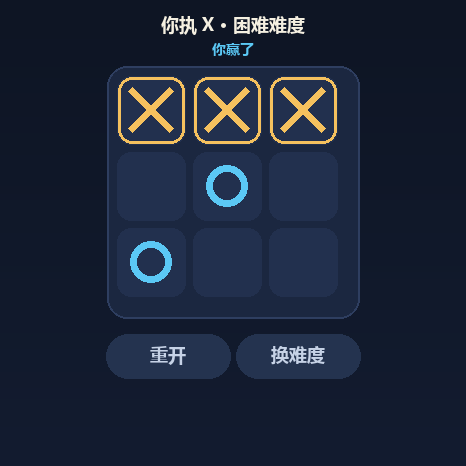

# 井字棋 · vivo 蓝河手表（BlueOS）

抬手即玩的三子连线小游戏，跑在 vivo 蓝河手表上。支持**同桌双人对弈**与**三档 AI 人机对战**。

| 主菜单 · 模式选择 | 双人模式 · 对局 | 三连获胜 |
|---|---|---|
|  |  |  |

> 上面是 `tools/preview.py` 依据 `index.ux` 真实尺寸生成的 466×466 预览图（与代码同源，改代码会同步重出），不是模拟器实拍。

## 玩法

- **双人模式** —— 同桌两人在同一块表上轮流落子，X 先手、O 后手，先连成三子者获胜。没有 AI 参与，纯面对面对弈。
- **人机对战** —— 三档 AI：
  - **简单**：随手落子，入门练手
  - **普通**：会堵你的连线，但偶尔露破绽
  - **困难**：完整 minimax 全量搜索，你走错一步就赢不了它

胜负连线自动金色高亮；当前回合实时提示；人机模式本地记录胜/负/平（双人模式不计战绩）；模式与难度选择会持久化。

## 用 BlueOS Studio 打开

这是完整的 BlueOS 标准工程，直接用 BlueOS Studio「打开文件夹」选中本目录即可加载，**无需 npm install**（零运行时依赖）。

- 入口页面：`src/pages/Index/index.ux`
- 应用配置：`src/manifest.json`
- 适配 watch / watch-round / watch-square 三种表型

## 打包 release 安装包

构建工具在 BlueOS Studio 安装目录里（不在 npm 全局）：

```bash
node "D:/Blueos/BlueOSStudio/resources/app/extensions/node_modules/hap-toolkit/bin/index.js" release
```

产物 → `dist/com.fboy.tictactoe.release.1.0.0.rpk`。

签名证书放 `sign/`（已 gitignore，不入库），文件名必须是 `certificate.pem` + `private.pem`。

## 目录

```
src/
  app.ux                     应用入口
  manifest.json              应用清单（包名 / 版本 / 设备类型 / 路由）
  assets/images/logo.png     应用图标
  pages/Index/index.ux       主界面（菜单 / 对局 / 结算 三态单页）
  systems/ai.js              棋局规则 + negamax AI（纯逻辑，零平台依赖）
  systems/store.js           战绩 / 模式持久化
tools/
  smoke.mjs                  AI 逻辑断言
  duo_check.mjs              双人模式页面逻辑断言（无需模拟器）
  lint_ux.mjs                .ux 模板静态合规自检
  neg_check.mjs / neg_lint.mjs  反向验证（注入 bug 看守卫是否变红）
  preview.py                 466x466 视觉预览图生成（需 Pillow）
```

## 自检

```bash
npm run check   # smoke(38) + duo(49) + lint
npm run neg     # 反向验证
```

## 已知问题

本地存档使用 `$feature('blueos.storage.storage')`，该接口在新版平台已废弃，会打印日志警告且**战绩持久化失效**；核心下棋与对局功能不受影响。
